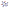

# smiles2svg

[](LICENSE)
[](https://smiles2svg.readthedocs.io/en/latest/?badge=latest)

Convert [SMILES](https://en.wikipedia.org/wiki/Simplified_molecular-input_line-entry_system) strings into 2D molecular structure diagrams as **SVG**, with optional **PNG** export (via [Cairo](https://www.cairographics.org/)).

## Install

```bash
pip install .
```

Editable install for development:

```bash
pip install -e ".[dev,docs]"
```

Runtime dependencies are declared in `pyproject.toml` (`rdkit`, `svgwrite`, `numpy`, `cairosvg`). On Linux, install Cairo development packages (e.g. `libcairo2-dev`) if you need PNG output.

## Command line

```bash
smiles2svg -s 'Cn1cnc2n(C)c(=O)n(C)c(=O)c12'
```

Creates `Cn1cnc2n(C)c(=O)n(C)c(=O)c12.svg` in the current directory.

```bash
python -m smiles2svg -h
```

### Batch input

A text file with one SMILES per line:

```bash
smiles2svg -f examples/smiles.txt
```

### Custom output basename (single structure only)

```bash
smiles2svg -s 'c1ccccc1' -n benzene
```

Writes `benzene.svg` (and `benzene.png` if `--png` is set).

### PNG export

```bash
smiles2svg -s 'CCO' --png --png-width 900
```

## Python API

```python
from smiles2svg import render_smiles_to_svg

svg = render_smiles_to_svg("c1ccccc1", style="plain")
# Pass output_path="out.svg" to also write a file.
```

## Drawing styles

| Style | Description |
|-------|-------------|
| `plain` | Colored disks; carbon atoms unlabeled |
| `names_hetero` | Element symbols on heteroatoms |
| `names_all` | Symbols on every atom |
| `stroke` | Filled disks with bond-colored outline |

Use `--style` on the CLI or the `style=` argument in `render_smiles_to_svg`.

### Examples (default style)

```bash
smiles2svg -s 'Cn1cnc2n(C)c(=O)n(C)c(=O)c12'
```


### Stroke, labels, color, implicit H on donors

<p align="middle">
  
  
  
  
</p>

```bash
smiles2svg -s 'Cn1cnc2n(C)c(=O)n(C)c(=O)c12' --style stroke
smiles2svg -s 'Cn1cnc2n(C)c(=O)n(C)c(=O)c12' --style names_hetero
smiles2svg -s 'Cn1cnc2n(C)c(=O)n(C)c(=O)c12' --style names_all
smiles2svg -s 'Cn1cnc2n(C)c(=O)n(C)c(=O)c12' --style names_hetero --color '#468BFF'
```

### Implicit hydrogens on H-bond donors

```bash
smiles2svg -s 'Cn1cnc2n(C)c(=O)n(C)c(=O)c12' --add-hydrogens
```


## Documentation

Full documentation (installation, API, contributing) is hosted on [Read the Docs](https://smiles2svg.readthedocs.io).

Build locally:

```bash
pip install -e ".[docs]"
cd docs && make html
```

## Contributing

See [CONTRIBUTING.md](CONTRIBUTING.md).

## License

MIT — see [LICENSE](LICENSE).

## Roadmap (from original project)

- [x] Custom font
- [x] PNG export
- [x] Custom basename for output files
- [x] Stroke style for all atoms
- [x] Optional implicit H on typical donors
- [ ] Improve text centering for labels
- [ ] Bond color gradients between atoms
- [ ] Lone pairs
