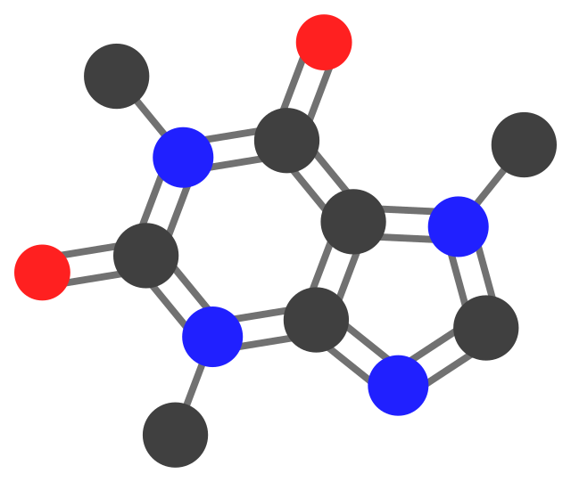

Quickstart
==========

Generate an SVG for **caffeine** in the current directory:

.. code-block:: bash

   smiles2svg -s 'Cn1cnc2n(C)c(=O)n(C)c(=O)c12'

This writes ``Cn1cnc2n(C)c(=O)n(C)c(=O)c12.svg``. Use a custom basename:

.. code-block:: bash

   smiles2svg -s 'Cn1cnc2n(C)c(=O)n(C)c(=O)c12' -n caffeine

**Python API**

.. code-block:: python

   from smiles2svg import render_smiles_to_svg

   svg = render_smiles_to_svg("c1ccccc1", style="plain")
   print(svg[:200])

   Default ``plain`` style (caffeine).

See :doc:`cli` and :doc:`../user_guide/styles` for drawing options.
