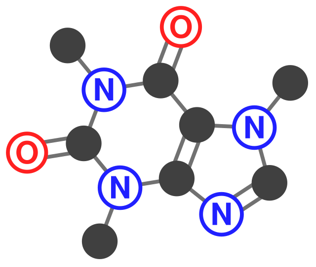

smiles2svg
===========

**smiles2svg** turns `SMILES <https://en.wikipedia.org/wiki/Simplified_molecular-input_line-entry_system>`_ strings into 2D molecular diagrams as **SVG** (and optionally **PNG**), with several drawing styles and a pixel-based layout.

   Caffeine (heteroatom labels): ``Cn1cnc2n(C)c(=O)n(C)c(=O)c12``

.. toctree::
   :maxdepth: 2
   :caption: Getting started

   getting_started/index
   getting_started/installation
   getting_started/quickstart
   getting_started/cli

.. toctree::
   :maxdepth: 2
   :caption: User guide

   user_guide/index
   user_guide/styles
   user_guide/canvas
   user_guide/python_api

.. toctree::
   :maxdepth: 2

   examples
   citation
   api
   contributing

Indices
-------

* :ref:`genindex`
* :ref:`modindex`
* :ref:`search`
