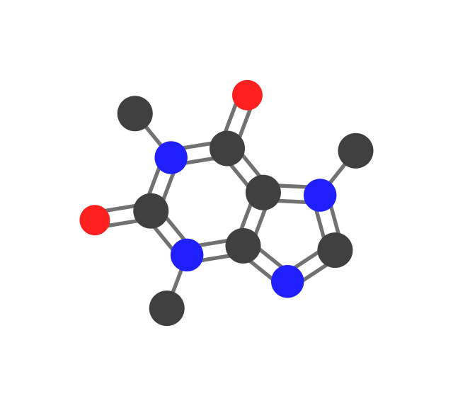

Drawing styles
================

Styles are chosen with ``--style`` or the ``style=`` argument in Python.

.. list-table::
   :header-rows: 1
   :widths: 20 40 40

   * - Style
     - Description
     - Example (caffeine)
   * - ``plain``
     - Colored disks; carbon atoms not labeled.
     - .. image:: ../_static/images/caffeine_plain.svg
          :width: 200px
   * - ``names_hetero``
     - Element symbols on heteroatoms (N, O, …).
     - .. image:: ../_static/images/caffeine_hetero.svg
          :width: 200px
   * - ``names_all``
     - Symbols on every atom, including carbon.
     - .. image:: ../_static/images/caffeine_all.svg
          :width: 200px
   * - ``stroke``
     - Filled disks with an outline.
     - .. image:: ../_static/images/caffeine_stroke.svg
          :width: 200px

Implicit hydrogens on donors
----------------------------

``--add-hydrogens`` adds small H markers on typical H-bond donors (e.g. O, N).

   Caffeine with ``--add-hydrogens``.
